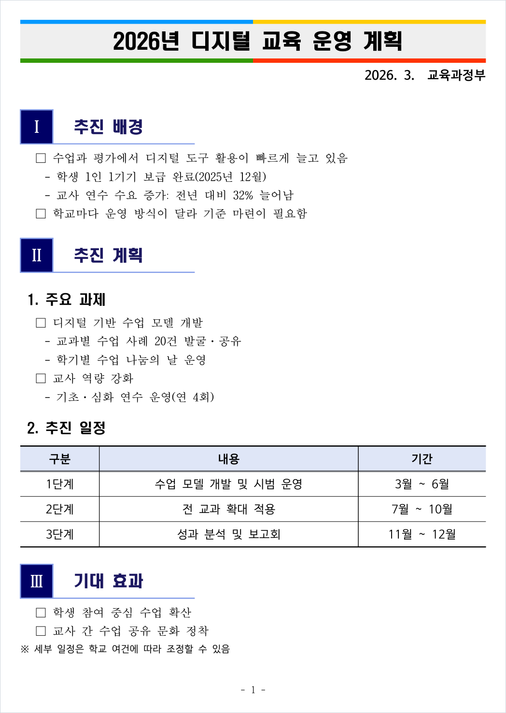
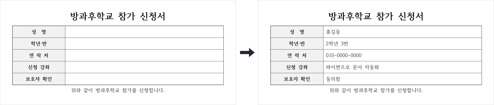

<p align="center">
  <h1 align="center">python-hwpx</h1>
  <p align="center">
    <strong>한컴오피스 없이 한/글 문서(HWPX·HWP)를 읽고, 고치고, 만드는 파이썬 엔진</strong>
  </p>
  <p align="center">
    <a href="https://pypi.org/project/python-hwpx/"></a>
    <a href="https://pepy.tech/project/python-hwpx"></a>
    <a href="https://pypi.org/project/python-hwpx/"></a>
    <a href="https://github.com/airmang/python-hwpx/actions/workflows/tests.yml"></a>
    <a href="https://github.com/airmang/python-hwpx/blob/main/LICENSE"></a>
  </p>
  <p align="center">
    한국어 | <a href="https://github.com/airmang/python-hwpx/blob/main/README_EN.md">English</a>
    · <a href="https://github.com/airmang/python-hwpx/blob/main/docs/quickstart.md">퀵스타트</a>
    · <a href="https://github.com/airmang/python-hwpx/blob/main/docs/usage.md">사용 가이드</a>
    · <a href="https://airmang.github.io/python-hwpx/">API 레퍼런스</a>
    · <a href="https://github.com/airmang/python-hwpx/blob/main/docs/migration-7.0.md">7.0 이주 가이드</a>
  </p>
</p>

python-docx가 `.docx`를 다루듯, python-hwpx는 한/글 문서를 다룹니다. HWPX는 XML(OWPML)을 ZIP으로 묶은 형식이라
한컴오피스 없이도 읽고 쓸 수 있습니다. Windows·macOS·Linux는 물론 CI에서도 돌아가고, 필요한 패키지는 `lxml` 하나뿐입니다.
HWP 5.0(`.hwp`) 파일도 같은 API로 열어 HWPX로 저장할 수 있습니다.

<p align="center">
  
</p>
<p align="center"><sub>python-hwpx 7.0.0 위에서 python-hwpx-automation 8.0의 보고서 서식(<code>from_markdown(md, style="report")</code>)으로 만든 문서를 한컴오피스 12.30.0이 그린 쪽(PDF로 내보낸 것).</sub></p>

> **7.0이 나왔습니다.** 저장 함수와 공개 이름이 바뀌었고, 일부 기능은 다른 패키지로 옮겼습니다.
> 6.x를 쓰고 있었다면 [7.0에서 무엇이 왜 바뀌었나](#70에서-무엇이-왜-바뀌었나)부터 읽어 주세요.

## 설치

```bash
pip install -U python-hwpx      # Python 3.10+
```

## 빠른 시작

새 문서를 만들어 봅니다. 스타일은 이름으로 지정하며, 문서에 없는 이름을 쓰면 그 자리에서 오류가 납니다.

<!-- standalone-python-example -->

```python
from hwpx import HwpxDocument

doc = HwpxDocument.new()
doc.add_heading("2026 운영계획", level=1)
doc.add_paragraph("추진 배경", style="개요 2")  # 한/글이 "가." 번호를 붙인다
doc.save("계획.hwpx")
```

글자 크기와 정렬, 표 칸은 바로 읽고 고칠 수 있습니다. 표 칸·머리말·각주에 든 문단까지 위치와 함께 차례로 훑을 수도 있습니다.

<!-- standalone-python-example -->

```python
from hwpx import HwpxDocument

doc = HwpxDocument.new()
title = doc.add_paragraph("2026 운영계획")
title.alignment = "CENTER"
title.runs[-1].size = 16
table = doc.add_table(2, 2)
table.cell(0, 0).text = "기간"
table.cell(0, 1).text = "3월 ~ 7월"
for place in doc.text.iter_paragraphs(where={"cell"}):
    print(place.row, place.col, place.paragraph.text)
doc.save("계획.hwpx")
```

### 양식 채우기

기존 문서는 `HwpxDocument.open("보고서.hwpx")`로 엽니다. `.hwp` 파일도 똑같이 열리며, 고친 결과는 HWPX로 저장됩니다.
양식에 값만 채우고 나머지는 원본 그대로 두고 싶다면 `mode="patch"`로 저장하세요.

```python
doc = HwpxDocument.open("신청서.hwpx")
for cell in doc.tables.map()["tables"][0]["cells"]:   # 표의 칸마다 행·열과 글
    print(cell["row"], cell["col"], cell["text"])       # 0 0 성  명 / 0 1 (빈 칸) ...
doc.tables[0].cell(0, 1).text = "홍길동"
doc.tables[0].cell(1, 1).text = "플랫폼팀"
report = doc.save("신청서-작성완료.hwpx", mode="patch", fallback="error")
```

<p align="center">
  
</p>
<p align="center"><sub>빈 양식(왼쪽)과 <code>mode="patch"</code>로 값만 채운 양식(오른쪽). 둘 다 한컴오피스가 그린 쪽입니다.</sub></p>

`mode="patch"`로 저장하면 손대지 않은 부분은 압축된 바이트까지 원본과 같습니다. 아무것도 고치지 않았다면 파일 전체가
원본과 똑같습니다. 무엇이 바뀌었는지는 `save()`가 돌려주는 보고서(`MutationReport`)에서 확인할 수 있습니다.

칸 안에 표가 들어 있는 양식이라면 주의할 점이 하나 있습니다. `doc.tables.map()`의 표 번호(`table_index`)는 안쪽 표까지 센
번호이므로, 표를 고를 때는 `doc.tables.with_nested[table_index]`를 쓰세요. 이름표 글자로 칸을 찾아 채우는 기능은
[python-hwpx-automation](#함께-쓰는-패키지)에 있습니다.

<sub>앞의 두 예제는 그대로 실행됩니다. 세 번째처럼 내 문서가 있어야 돌아가는 조각까지, 예제마다의 Python 블록 판정은
[실행 기록](https://github.com/airmang/python-hwpx/blob/main/docs/python-example-ledger.json)에 남겨 둡니다.</sub>

## 할 수 있는 것

| | |
|---|---|
| **읽기** | 한/글의 "텍스트로 저장"과 같은 평문(`doc.text.plain()`), 정해진 글자 수 안의 개요(`doc.text.outline()`), 표 칸·글상자·머리말·각주 속 문단과 그 위치(`doc.text.iter_paragraphs()`) |
| **편집** | 문단과 런, 글자·문단 서식, 머리말·꼬리말, 쪽 설정과 쪽 번호, 그림, 도형, 수식, 메모, 각주·미주 |
| **표** | 칸 읽고 쓰기, 행·열 넣기·지우기·옮기기, 칸 합치기·나누기, 테두리와 채우기, 칸 안의 표 |
| **양식** | 누름틀 읽고 채우기, 값만 넣는 패치 저장, 값이 칸에 들어가도록 줄을 바꾸거나 글자를 줄이는 FormFit |
| **문서 구조** | 차례, 상호 참조, 책갈피, 하이퍼링크, 변경 추적, 문서끼리 복사·병합 |
| **HWP 5.0** | `.hwp`를 같은 API로 읽어 HWPX로 저장. 옮기지 못한 내용은 `doc.conversion_report`에 기록. `.hwp`로 다시 쓰기는 실험 기능 |
| **검사** | 패키지 구조 검사, 저장 전 한/글 열림 검사, 저장 품질 정책(`QualityPolicy`) |
| **배치 추정** (실험) | 한/글 없이 쪽 수와 줄 위치 추정(`estimate_pages`), 확실한 문단에만 줄 배치 정보 쓰기(`write_line_caches`) |

개발 단계는 안정(Production/Stable)입니다. 하위 호환을 약속하는 범위는 [안정 API 표면](https://github.com/airmang/python-hwpx/blob/main/docs/stable-api.md)에
정리해 두었습니다. `hwpx.experimental`과 위 표에서 "실험"으로 표시한 기능은 바뀔 수 있습니다.

## 7.0에서 무엇이 왜 바뀌었나

7.0에서 지킨 원칙은 하나입니다. **엔진은 파일에 적힌 것과 다른 값을 돌려주지 않고, 한/글이 받아들이지 않을 파일을 쓰지
않습니다.** 같은 파일에는 언제나 같은 결과를 내고, 한/글에서 확인한 근거가 없는 쓰기는 하지 않습니다. 아래 여섯 가지 변경은
모두 이 원칙에서 나왔습니다.

### 1. 짐작이 필요한 기능은 python-hwpx-automation으로 옮겼습니다

**바뀐 것:** Markdown·HTML 변환, 다른 형식 가져오기, LangChain·LlamaIndex 연동, 이름표로 양식 칸 찾기, 메일 머지, 미리보기,
서식 규칙 검사를 [python-hwpx-automation](https://github.com/airmang/python-hwpx-automation) 8.0으로 옮겼습니다.

**왜:** 이런 기능에는 정답이 하나로 정해져 있지 않습니다. 이름표 옆 칸이 정말 그 항목을 적는 칸인지, Markdown 제목을 어떤
모양으로 옮길지는 결국 짐작이나 취향의 문제입니다. 엔진 안에 짐작이 섞이면 "파일에 적힌 그대로"라는 약속을 기계로 검증할 수
없게 됩니다. 그래서 파일에 적힌 것을 읽고 쓰는 일은 엔진에, 짐작하고 고르는 일은 자동화 패키지에 두었습니다.

기능이 사라진 것은 아닙니다. 인자와 결과는 6.x와 같고, 옛 이름을 부르면 새 위치를 알려 주는 오류가 납니다. 엔진이 의존하는
패키지는 여전히 `lxml` 하나입니다.

### 2. 저장은 `doc.save()` 하나로 합쳤습니다

**바뀐 것:** `save_to_path`·`save_to_stream`·`save_report`를 `doc.save(target)` 하나로, `from_package`를 `open()`으로 합쳤습니다.
`save()`는 경로와 스트림을 모두 받고, 언제나 `MutationReport`를 돌려줍니다.

**왜:** 네 함수는 하는 일이 겹치는데도 돌려주는 값이 `None`, 경로, 보고서로 제각각이었습니다. 저장 결과를 확인하려면 어떤
함수를 써야 하는지부터 기억해야 했습니다. 이제는 어떻게 저장하든 결과가 같은 형태로 돌아오고, 스트림에 저장하다 실패하면
쓰기 전 상태로 되돌립니다.

### 3. 공개 이름을 한 가지 규칙으로 정리하고 고정했습니다

**바뀐 것:** `row_index=` → `row=`, `horz_rel_to=` → `horizontal_relative_to=`, `line_width='33'` → `line_width_mm=0.12`,
`table.get_cell_map()` → `table.cell_map`처럼 이름을 고쳤습니다. 6.0에서 경고와 함께 남겨 두었던 루트의 옛 이름 79개도 지웠습니다.

**왜:** 6.x에는 줄임말, XML 속성 이름을 그대로 옮긴 이름, 단위 없는 숫자, `get_` 접두사가 뒤섞여 있어 이름을 하나하나 외워야
했습니다. `'33'`만 봐서는 무슨 단위인지 알 수 없는 식입니다. 이제 규칙은 세 가지입니다. 이름은 줄이지 않고 풀어 쓰고, 단위는
이름에 붙이고, 인자가 없는 읽기는 속성으로 둡니다.

이번이 마지막 이름 변경입니다. 공개 이름은 `tests/data/public_surface.json`에 고정해 두었고, 다음 major 판까지 바꾸지 않습니다.
한꺼번에 정리하면서 6.x에서 미리 경고하지 않았던 이름(저장 함수 등)도 함께 지웠는데, 이는
[안정 API 규칙](https://github.com/airmang/python-hwpx/blob/main/docs/stable-api.md)의 예외입니다. 그 대신 지운 이름을 부르면
새 이름과 한 줄짜리 예시를 바로 알려 줍니다.

### 4. 한/글이 받아들이지 않을 쓰기는 거부합니다

**바뀐 것:** 엔진이 새로 쓰는 XML은 모두 한/글이 실제로 저장한 파일을 근거로 삼습니다. 근거가 없는 조합은 쓰기 전에 `code`가
붙은 오류로 거부하며, 거부된 호출은 문서를 전혀 바꾸지 않습니다. 문서에서 떼어 낸 표나 문단을 통해 문서를 고치려 해도 거부하고,
읽기만 해서 문서가 바뀌는 일도 없습니다. `.hwp`로 쓰기는 실험 기능으로 두되, 원본을 덮어쓰거나 옮기지 못한 내용이 있는 경우에는
쓰지 않습니다.

**왜:** 가장 나쁜 실패는 오류 없이 저장됐는데 한/글에서 열리지 않거나 다르게 보이는 파일입니다. 틀린 파일을 조용히 만드느니,
분명하게 거부하고 이유를 알려 주는 편이 낫습니다.

### 5. XML을 직접 고쳐야 했던 일을 공개 API로 열었습니다

**바뀐 것:** 표 구조 편집, 개체의 위치·회전·뒤집기, 글자·문단 서식, 누름틀, 각주·미주, 차례, 상호 참조, 변경 추적을 공개 API로
다룰 수 있습니다.

**왜:** 6.x에서는 이런 작업을 하려면 `.element`로 XML을 직접 고쳐야 했고, 그렇게 고친 내용은 엔진의 검사를 거치지 않았습니다.
공개 API를 쓰면 4번의 거부와 검사가 함께 적용됩니다. 본체 코드가 6.12.0보다 약 2만 1천 줄(23%) 늘어난 것도 대부분 이
때문입니다. `.element`는 탈출구로 남겨 두었지만 호환을 약속하는 표면은 아닙니다.

### 6. 새 문서가 빈 줄로 시작하지 않습니다

**바뀐 것:** `HwpxDocument.new()`로 만든 문서에 처음 더한 문단이 `doc.paragraphs[0]`이 됩니다.

**왜:** 6.x에서는 새 문서가 늘 빈 줄로 시작해서, 완성한 문서 맨 위에 쓸모없는 빈 줄이 남았습니다. 이 변경은 오류 없이 문단
번호만 하나씩 당겨지므로 [이주 가이드](https://github.com/airmang/python-hwpx/blob/main/docs/migration-7.0.md) 맨 앞에 따로
적어 두었습니다. 6.x처럼 빈 줄로 시작하려면 `HwpxDocument.new(empty_first_line=True)`를 쓰세요.

### 올리는 법

1. `pip install -U python-hwpx`로 올립니다.
2. 테스트를 돌립니다. 지운 이름을 쓰는 곳에서는 오류가 새 이름을 알려 줍니다.
3. 오류 없이 결과만 달라지는 경우는 [7.0 이주 가이드](https://github.com/airmang/python-hwpx/blob/main/docs/migration-7.0.md)의 표로 확인합니다.
4. 1번에서 옮긴 기능을 쓰고 있다면 `pip install -U "python-hwpx-automation>=8"`도 설치합니다.

바뀐 내용 전체는 [변경 기록](https://github.com/airmang/python-hwpx/blob/main/CHANGELOG.md)에 있습니다.

## 한/글에서 열리는가

python-hwpx로 만든 파일을 실제 한컴오피스에서 열어 보고, 확인한 판과 날짜를 함께 적습니다.

- **7.0.0** (2026-11-21, macOS 한컴오피스 12.30.0): 7.0.0 휠로 만든 문서 72개가 모두 열렸습니다. 다른 사람이 만든 실제 문서
  27종을 고친 54개, 새로 만든 문서, 문서끼리 복사·병합한 결과가 들어 있습니다. Windows용 한/글에서는 아직 확인하지 않았습니다.
- 이전 판의 전체 코퍼스 측정 결과는 [실측 코퍼스 메트릭](https://airmang.github.io/python-hwpx/corpus-metrics.html)에 있습니다.

이 결과는 한/글이 파일을 문제없이 여는지를 확인한 것이며, 화면이 한/글과 똑같다는 뜻은 아닙니다. 엔진은 쪽 배치를 직접 하지
않습니다. 내용이 바뀐 문단은 줄 배치 정보를 지워 두고, 한/글이 파일을 열 때 다시 배치하게 합니다.

## 함께 쓰는 패키지

| | 저장소 | 역할 |
|---|---|---|
| 📦 | [`python-hwpx`](https://github.com/airmang/python-hwpx) | 한/글 문서를 읽고·고치고·만드는 엔진 (이 저장소) |
| 🔌 | [`python-hwpx-automation`](https://github.com/airmang/python-hwpx-automation) | 변환·양식 채움·메일 머지·미리보기, `hwpx` CLI, MCP 서버, 에이전트 플러그인 소스 |
| 🎯 | [`hwpx-plugins`](https://github.com/airmang/hwpx-plugins) | Claude Code·Codex 플러그인 설치 목록 (`hwpx-plugin@hwpx`) |

AI 에이전트에서 쓰려면 플러그인을 설치하세요.

```bash
claude plugin marketplace add airmang/hwpx-plugins && claude plugin install hwpx-plugin@hwpx
codex plugin marketplace add airmang/hwpx-plugins && codex plugin add hwpx-plugin@hwpx
```

일반 ChatGPT 대화에서도 쓸 수 있습니다. 채팅 속 파이썬 환경은 PyPI에 접속할 수 없으므로,
[최신 Release](https://github.com/airmang/python-hwpx/releases/latest)의 `python_hwpx-*.whl` 파일을 문서와 함께 올린 뒤
"첨부한 whl을 pip로 설치하고, 이 .hwpx를 python-hwpx로 열어서 작업해 줘"라고 요청하면 됩니다. 자세한 지시문은
[AI 채팅 환경에서 쓰기](https://github.com/airmang/python-hwpx/blob/main/docs/ai-assistants.md)에 있고, AI 도구가 API를 익히도록 만든
[llms.txt](https://airmang.github.io/python-hwpx/llms.txt)도 있습니다.

> 예전 설치 명령과의 호환을 위해 `pip install "python-hwpx[visual]"`도 그대로 동작합니다. 다만 이 extra는 비어 있어
> 렌더·PDF 의존성을 설치하지 않습니다. 그 일은 `python-hwpx-automation[oracle]`이 맡습니다.

## 비교

| | python-hwpx | pyhwpx | pyhwp |
|---|---|---|---|
| **한/글 설치** | 필요 없음 | 필요 (Windows COM으로 한/글을 조종) | 필요 없음 |
| **운영체제** | Linux · macOS · Windows · CI | Windows | Linux · macOS · Windows |
| **다루는 형식** | `.hwpx` 읽기·쓰기, `.hwp` 읽기 | 한/글이 여는 형식 | `.hwp` (v5) |
| **편집·생성** | ✅ | ✅ (한/글이 함) | 대부분 읽기 |

## 알려진 제약

- 엔진은 쪽 배치를 하지 않습니다. 차례나 상호 참조에 들어가는 쪽 번호는 한/글이 파일을 열 때 채웁니다.
- 쪽 수 추정과 줄 배치 정보 쓰기는 실험 기능입니다. 처리할 수 없는 요소를 만나면 추정하지 않고 그 이유를 돌려줍니다.
- `.hwp`로 쓰기는 실험 기능입니다. 암호가 걸린 HWPX와 암호·배포용 HWP는 지원하지 않습니다.
- `doc.shapes.add_raw()`·`add_control()`이나 `.element`로 직접 고친 XML은 엔진의 검사를 거치지 않습니다. 도형은
  `add_line()`·`add_rectangle()` 같은 `doc.shapes` 함수를 쓰세요.

남은 과제와 알려진 결함은 [이슈](https://github.com/airmang/python-hwpx/issues)에서 확인할 수 있습니다.

## 문서

[5분 퀵스타트](https://github.com/airmang/python-hwpx/blob/main/docs/quickstart.md) ·
[사용 가이드](https://github.com/airmang/python-hwpx/blob/main/docs/usage.md) ·
[예제](https://github.com/airmang/python-hwpx/blob/main/docs/examples.md) ·
[API 레퍼런스](https://airmang.github.io/python-hwpx/) ·
[안전한 쓰기 계약](https://github.com/airmang/python-hwpx/blob/main/docs/safe-write-contract.md) ·
[지원 매트릭스](https://github.com/airmang/python-hwpx/blob/main/docs/support-matrix.md) ·
[오류 코드](https://github.com/airmang/python-hwpx/blob/main/docs/error-codes.md) ·
[python-docx와 비교](https://github.com/airmang/python-hwpx/blob/main/docs/comparison-python-docx.md)

## 기여하기

[help wanted](https://github.com/airmang/python-hwpx/issues?q=is%3Aissue+is%3Aopen+label%3A%22help+wanted%22) ·
[로드맵](https://github.com/airmang/python-hwpx/milestones) ·
[Discussions](https://github.com/airmang/python-hwpx/discussions) ·
[CONTRIBUTING](https://github.com/airmang/python-hwpx/blob/main/CONTRIBUTING.md)

HWPX 내부 구조가 처음이라면 [내부 실전 가이드](https://github.com/airmang/python-hwpx/tree/main/docs/internals)부터 읽어 보세요.
패키지 사이의 경계는 [제품 경계 문서](https://github.com/airmang/python-hwpx/blob/main/docs/architecture/product-boundary.md)에 정리해 두었습니다.

## 감사의 말

- [OWPML, 개방형 워드프로세서 마크업 언어 (KS X 6101)](https://www.kssn.net/search/stddetail.do?itemNo=K001010119985): HWPX의 바탕이 된 한국 산업 표준
- [hancom-io/hwpx-owpml-model](https://github.com/hancom-io/hwpx-owpml-model): OWPML 요소 구조 참조 모델
- [neolord0/hwpxlib](https://github.com/neolord0/hwpxlib): 견본 코퍼스
- [edwardkim/rhwp](https://github.com/edwardkim/rhwp): 멱등성·검증 게이트 설계에 영감을 주었고, 다른 뷰어와의 호환을 확인할 때 씁니다
- 범정부오피스: 공문서 편집 워크플로 아이디어

## 라이선스

Apache-2.0 ([LICENSE](https://github.com/airmang/python-hwpx/blob/main/LICENSE) · [NOTICE](https://github.com/airmang/python-hwpx/blob/main/NOTICE)) · Kohkyuhyun [@airmang](https://github.com/airmang) · [kokyuhyun@hotmail.com](mailto:kokyuhyun@hotmail.com)
