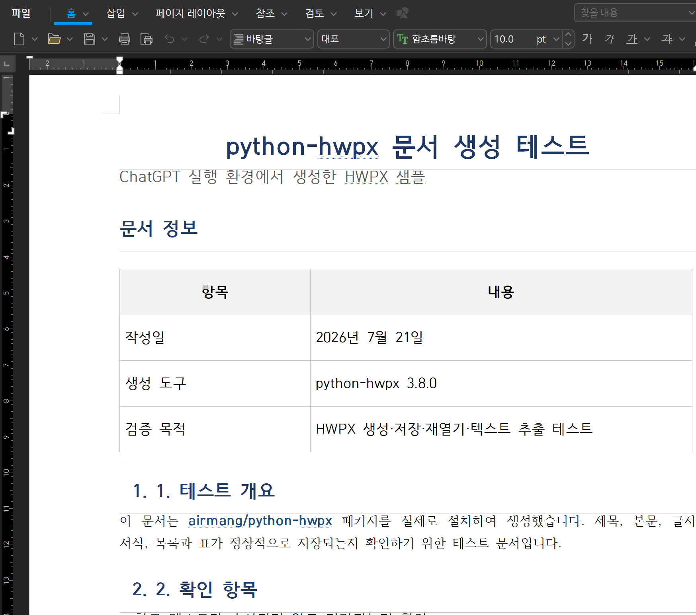
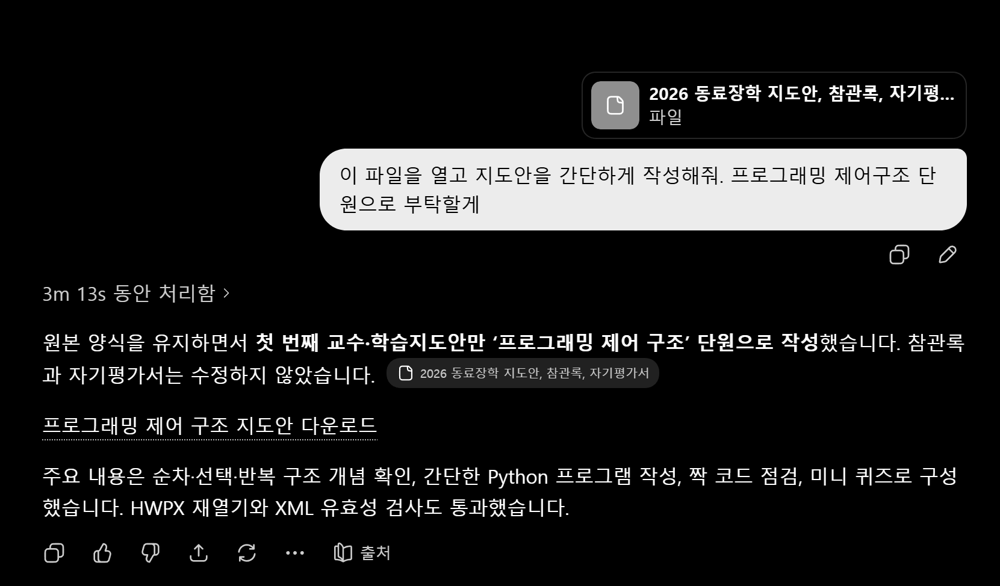

<p align="center">
  <h1 align="center">python-hwpx</h1>
  <p align="center">
    <strong>한컴오피스 없이 한/글 문서(HWPX·HWP)를 읽고 고치고 만드는 파이썬 엔진</strong>
  </p>
  <p align="center">
    <a href="https://pypi.org/project/python-hwpx/"></a>
    <a href="https://pepy.tech/project/python-hwpx"></a>
    <a href="https://pypi.org/project/python-hwpx/"></a>
    <a href="https://github.com/airmang/python-hwpx/actions/workflows/tests.yml"></a>
    <a href="https://github.com/airmang/python-hwpx/blob/main/LICENSE"></a>
  </p>
  <p align="center">
    한국어 | <a href="https://github.com/airmang/python-hwpx/blob/main/README_EN.md">English</a>
    · <a href="https://github.com/airmang/python-hwpx/blob/main/docs/quickstart.md">퀵스타트</a>
    · <a href="https://github.com/airmang/python-hwpx/blob/main/docs/usage.md">사용 가이드</a>
    · <a href="https://airmang.github.io/python-hwpx/">API 레퍼런스</a>
    · <a href="https://github.com/airmang/python-hwpx/blob/main/docs/migration-7.0.md">7.0 이주 가이드</a>
  </p>
</p>

python-docx가 `.docx`에 하는 일을 python-hwpx는 한/글 문서에 합니다. HWPX는 ZIP 안에 XML(OWPML)을 담은
형식이라 한컴오피스가 없어도 다룰 수 있습니다. Windows·macOS·Linux·CI 어디서나 돌고, 의존성은 `lxml` 하나입니다.
HWP 5.0(`.hwp`)도 같은 API로 열어 HWPX로 저장합니다.

> **7.0이 나왔습니다.** 저장 함수, 공개 이름, 일부 기능의 자리가 바뀌었습니다.
> 6.x에서 올라온다면 [7.0에서 무엇이 왜 바뀌었나](#70에서-무엇이-왜-바뀌었나)부터 보세요.

## 설치

```bash
pip install -U python-hwpx      # Python 3.10+
```

## 빠른 시작

새 문서를 만듭니다. 스타일은 이름으로 고르고, 없는 이름을 쓰면 그 줄에서 바로 오류가 납니다.

<!-- standalone-python-example -->

```python
from hwpx import HwpxDocument

doc = HwpxDocument.new()
doc.add_heading("2026 운영계획", level=1)
doc.add_paragraph("추진 배경", style="개요 2")  # 한/글이 "가." 번호를 붙인다
doc.save("계획.hwpx")
```

글자 크기·정렬과 표 칸은 그 자리에서 읽고 고칩니다. 표 칸·머리말·각주까지 모든 문단을 자리와 함께 훑을 수 있습니다.

<!-- standalone-python-example -->

```python
from hwpx import HwpxDocument

doc = HwpxDocument.new()
title = doc.add_paragraph("2026 운영계획")
title.alignment = "CENTER"
title.runs[-1].size = 16
table = doc.add_table(2, 2)
table.cell(0, 0).text = "기간"
table.cell(0, 1).text = "3월 ~ 7월"
for place in doc.text.iter_paragraphs(where={"cell"}):
    print(place.row, place.col, place.paragraph.text)
doc.save("계획.hwpx")
```

있는 문서는 `HwpxDocument.open("보고서.hwpx")`로 엽니다. `.hwp`도 똑같이 열리고, 고친 결과는 HWPX로 저장합니다.
양식에 값만 넣고 나머지는 바이트 그대로 두려면 `mode="patch"`로 저장합니다.

```python
doc = HwpxDocument.open("신청서.hwpx")
for cell in doc.tables.map()["tables"][0]["cells"]:   # 표의 칸마다 행·열과 글
    print(cell["row"], cell["col"], cell["text"])       # 0 0 성  명 / 0 1 (빈 칸) ...
doc.tables[0].cell(0, 1).text = "홍길동"
doc.tables[0].cell(1, 1).text = "플랫폼팀"
report = doc.save("신청서-작성완료.hwpx", mode="patch", fallback="error")
```

`mode="patch"`는 고치지 않은 ZIP 파트를 압축된 바이트까지 원본 그대로 옮깁니다. 아무것도 고치지 않은 저장은 파일째 같습니다.
`save()`가 돌려주는 보고서(`MutationReport`)에 무엇이 바뀌었는지 적혀 있습니다. 칸 안에 표가 있는 양식이라면,
`doc.tables.map()`의 표 번호(`table_index`)는 칸 안의 표까지 센 번호이므로 `doc.tables.with_nested[table_index]`로 고르세요.
이름표 글자로 칸을 찾아 채우는 일은 [python-hwpx-automation](#함께-쓰는-패키지)이 합니다.

<sub>첫 두 예제는 그대로 실행됩니다. 세 번째처럼 여러분의 문서를 입력으로 쓰는 조각까지, 예제별 Python 블록 판정은
[실행 기록](https://github.com/airmang/python-hwpx/blob/main/docs/python-example-ledger.json)에 남겨 둡니다.</sub>

## 할 수 있는 것

| | |
|---|---|
| **읽기** | 한/글의 "텍스트로 저장"과 같은 평문(`doc.text.plain()`), 글자 예산 안의 개요(`doc.text.outline()`), 표 칸·글상자·머리말·각주 문단을 자리와 함께(`doc.text.iter_paragraphs()`) |
| **편집** | 문단·런·글자와 문단 서식, 머리말·꼬리말, 쪽 설정·쪽 번호, 그림, 도형, 수식, 메모, 각주·미주 |
| **표** | 칸 읽기·쓰기, 행·열 넣기·지우기·옮기기, 칸 합치기·나누기, 테두리·채우기, 칸 안의 표 |
| **양식** | 누름틀 읽기·채우기, 칸에 값만 넣는 패치 저장, 값이 칸에 들어가게 줄을 바꾸거나 글자를 줄이는 FormFit |
| **문서 구조** | 차례, 상호 참조, 책갈피, 하이퍼링크, 변경 추적, 문서 사이 복사와 병합 |
| **HWP 5.0** | `.hwp`를 같은 API로 읽고 HWPX로 저장. 옮기지 못한 것은 `doc.conversion_report`에. `.hwp`로 다시 쓰기는 실험 |
| **검사** | 패키지 구조 검사, 한/글이 열 수 있는지 저장 전에 검사, 저장 품질 정책(`QualityPolicy`) |
| **배치 추정** (실험) | 한/글 없이 쪽 수와 줄 위치를 추정(`estimate_pages`), 확실한 문단에만 줄 배치 정보 쓰기(`write_line_caches`) |

개발 단계는 안정(Production/Stable)입니다. 하위 호환을 지키는 범위는 [안정 API 표면](https://github.com/airmang/python-hwpx/blob/main/docs/stable-api.md)에 있고,
`hwpx.experimental`과 위에서 "실험"이라고 적은 기능은 바뀔 수 있습니다.

## 7.0에서 무엇이 왜 바뀌었나

7.0의 기준은 하나입니다. **엔진이 알려 주는 것과 엔진이 쓴 파일은 늘 참이어야 합니다.** 같은 파일을 주면 같은 결과가
나오고, 결과는 파일에 적힌 그대로이며, 한/글이 받아들인다는 근거가 없는 쓰기는 하지 않습니다. 아래 여섯 가지는 모두 이
기준에서 나왔습니다.

### 1. 짐작하는 기능은 python-hwpx-automation으로 옮겼습니다

**바뀐 것** Markdown·HTML 변환, 다른 형식 가져오기와 LangChain·LlamaIndex 연동, 이름표로 양식 칸 찾기, 메일 머지,
미리보기, 서식 규칙 검사가 [python-hwpx-automation](https://github.com/airmang/python-hwpx-automation) 8.0으로 갔습니다.

**왜** 이 기능들은 정답이 하나가 아닙니다. 이름표 옆 칸이 정말 그 항목의 칸인지, Markdown 제목을 어떤 모양으로 옮길지는
짐작이고 취향입니다. 엔진에 짐작이 섞이면 "파일에 적힌 그대로"라는 약속을 기계로 확인할 수 없습니다. 그래서 선을 "파일에
적힌 것을 읽고 쓰는가, 짐작하고 고르는가"로 그었습니다. 기능이 없어지지는 않았습니다. 인자와 결과는 6.x와 같고, 옛 이름을
부르면 오류가 새 자리를 알려 줍니다. 엔진의 의존성은 그대로 `lxml` 하나입니다.

### 2. 저장은 `doc.save()` 하나입니다

**바뀐 것** `save_to_path`·`save_to_stream`·`save_report`가 `doc.save(target)` 하나로, `from_package`가 `open()`으로 모였습니다.
`save()`는 경로든 스트림이든 받고 늘 `MutationReport`를 돌려줍니다.

**왜** 네 함수가 하는 일은 겹치는데 돌려주는 값은 `None`·경로·보고서로 제각각이었습니다. 저장 결과를 확인하려면 어느 함수를
써야 하는지 외워야 했습니다. 이제 저장 결과는 언제나 같은 모양으로 돌아오고, 스트림 저장이 중간에 실패하면 쓰기 전 모습으로
되돌립니다.

### 3. 공개 이름을 한 가지 규칙으로 맞추고 얼렸습니다

**바뀐 것** `row_index=` → `row=`, `horz_rel_to=` → `horizontal_relative_to=`, `line_width='33'` → `line_width_mm=0.12`,
`table.get_cell_map()` → `table.cell_map`. 6.0이 경고와 함께 남겨 둔 루트의 옛 이름 79개를 지웠습니다.

**왜** 6.x에는 줄임말, XML 속성 이름을 그대로 옮긴 이름, 단위 없는 숫자(`'33'`이 무슨 단위인지 이름만 보고는 알 수 없습니다),
`get_` 접두사가 섞여 있어 API를 하나하나 외워야 했습니다. 규칙은 셋입니다. 이름은 풀어 쓰고, 단위는 이름에 붙이고, 인자 없는
읽기는 속성으로 합니다. 7.0이 마지막 이름 변경입니다. 공개 이름은 `tests/data/public_surface.json`에 고정했고 다음 major까지
바뀌지 않습니다.

한 번에 정리하느라 6.x가 미리 경고하지 않은 이름(저장 함수 등)도 함께 지웠습니다. [안정 API 규칙](https://github.com/airmang/python-hwpx/blob/main/docs/stable-api.md)의
예외입니다. 그 대신 지운 이름을 부르면 그 자리에서 새 이름과 한 줄 예를 알려 줍니다.

### 4. 한/글이 받아들이지 않을 쓰기는 거부합니다

**바뀐 것** 엔진이 새로 쓰는 XML 모양마다 한/글이 저장한 파일을 근거로 삼고, 근거가 없는 조합은 쓰기 전에 `code`가 붙은
오류로 거부합니다. 거부한 호출은 문서를 조금도 바꾸지 않습니다. 문서에서 떼어 낸 표나 문단으로 문서 쪽을 고치려 하면 거부하고,
읽기만 해서는 문서가 바뀌지 않습니다. `.hwp`로 쓰기는 실험 기능으로 두고, 원본을 덮어쓰거나 옮기지 못한 내용이 있는 쓰기는 막습니다.

**왜** 가장 나쁜 실패는 오류 없이 저장됐는데 한/글이 열지 못하거나 다르게 그리는 파일입니다. 조용히 틀리느니 분명히 거부하고
이유를 알려 주는 쪽을 골랐습니다.

### 5. XML을 직접 고치던 일을 공개 API로 열었습니다

**바뀐 것** 표 구조 편집, 개체의 위치·회전·뒤집기, 글자·문단 서식, 누름틀, 각주·미주, 차례, 상호 참조, 변경 추적을
공개 API로 할 수 있습니다.

**왜** 6.x에서는 이런 일을 하려면 `.element`로 XML을 직접 고쳐야 했고, 그렇게 고친 것은 엔진의 검사를 거치지 않았습니다.
공개 API로 하면 4번의 거부와 검사가 함께 갑니다. 본체가 6.12.0보다 약 2만 1천 줄(23%) 늘어난 것은 대부분 이 때문입니다.
`.element`는 탈출구로 남지만 약속하는 표면은 아닙니다.

### 6. 새 문서가 빈 줄로 시작하지 않습니다

**바뀐 것** `HwpxDocument.new()` 뒤 처음 더한 문단이 `doc.paragraphs[0]`입니다.

**왜** 6.x의 새 문서는 늘 빈 줄로 시작해서, 만든 문서 맨 위에 쓸모없는 빈 줄이 남았습니다. 오류 없이 문단 번호가 하나씩
당겨지는 변경이므로 [이주 가이드](https://github.com/airmang/python-hwpx/blob/main/docs/migration-7.0.md) 맨 앞에 적어 두었습니다.
6.x처럼 시작하려면 `HwpxDocument.new(empty_first_line=True)`입니다.

### 올리는 법

1. `pip install -U python-hwpx`
2. 테스트를 돌립니다. 지운 이름은 오류가 새 이름을 알려 줍니다.
3. 오류 없이 결과만 달라지는 것은 [7.0 이주 가이드](https://github.com/airmang/python-hwpx/blob/main/docs/migration-7.0.md)의 표로 확인합니다.
4. 1번에서 말한 기능을 쓴다면 `pip install -U "python-hwpx-automation>=8"`.

전체 목록은 [변경 기록](https://github.com/airmang/python-hwpx/blob/main/CHANGELOG.md)에 있습니다.

## 한/글에서 열리는가

만든 파일을 실제 한컴오피스로 열어 보고, 잰 판과 날짜를 함께 적습니다.

- **7.0.0** (2026-11-21, 한컴오피스 12.30.0 macOS): 7.0.0 휠로 만든 문서 72개가 모두 열렸습니다. 남이 만든 실제 문서
  27종을 고친 54개, 새로 만든 문서, 문서 사이 복사·병합 결과가 들어 있습니다. Windows 한/글에서는 아직 확인하지 않았습니다.
- 이전 판의 전체 코퍼스 측정은 [실측 코퍼스 메트릭](https://airmang.github.io/python-hwpx/corpus-metrics.html)에 있습니다.

이 숫자는 한/글이 파일을 받아들이는지를 잰 것이고, 화면이 한/글과 똑같다는 뜻은 아닙니다. 엔진은 쪽을 배치하지 않습니다.
글이 바뀐 문단의 줄 배치 정보를 지워 두면 한/글이 열 때 다시 배치합니다.

<p align="center">
  
</p>

## 함께 쓰는 패키지

| | 저장소 | 역할 |
|---|---|---|
| 📦 | [`python-hwpx`](https://github.com/airmang/python-hwpx) | 한/글 문서를 읽고·고치고·만드는 엔진 (이 저장소) |
| 🔌 | [`python-hwpx-automation`](https://github.com/airmang/python-hwpx-automation) | 변환·양식 채움·메일 머지·미리보기, `hwpx` CLI, MCP 서버, 에이전트 플러그인 소스 |
| 🎯 | [`hwpx-plugins`](https://github.com/airmang/hwpx-plugins) | Claude Code·Codex 플러그인 설치 목록 (`hwpx-plugin@hwpx`) |

에이전트에서 쓰려면 플러그인을 설치합니다.

```bash
claude plugin marketplace add airmang/hwpx-plugins && claude plugin install hwpx-plugin@hwpx
codex plugin marketplace add airmang/hwpx-plugins && codex plugin add hwpx-plugin@hwpx
```

일반 ChatGPT 대화에서도 씁니다. 채팅의 파이썬 환경은 PyPI에 접속하지 못하므로, [최신 Release](https://github.com/airmang/python-hwpx/releases/latest)의
`python_hwpx-*.whl`을 문서와 함께 올리고 "첨부한 whl을 pip로 설치한 다음 이 .hwpx를 python-hwpx로 열어 작업해 줘"라고 부탁합니다.
자세한 지시문은 [AI 채팅 환경에서 쓰기](https://github.com/airmang/python-hwpx/blob/main/docs/ai-assistants.md)에, AI 도구용
[llms.txt](https://airmang.github.io/python-hwpx/llms.txt)도 있습니다.

<p align="center">
  
</p>

> 예전 설치 명령을 위해 `pip install "python-hwpx[visual]"`도 계속 됩니다. 다만 이 extra는 비어 있어
> 렌더·PDF 의존성을 설치하지 않습니다. 그 일은 `python-hwpx-automation[oracle]`이 맡습니다.

## 비교

| | python-hwpx | pyhwpx | pyhwp |
|---|---|---|---|
| **한/글 설치** | 필요 없음 | 필요 (Windows COM으로 한/글을 조종) | 필요 없음 |
| **운영체제** | Linux · macOS · Windows · CI | Windows | Linux · macOS · Windows |
| **다루는 형식** | `.hwpx` 읽기·쓰기, `.hwp` 읽기 | 한/글이 여는 형식 | `.hwp` (v5) |
| **편집·생성** | ✅ | ✅ (한/글이 함) | 대부분 읽기 |

## 알려진 제약

- 엔진은 쪽을 배치하지 않습니다. 쪽 번호가 들어가는 차례·상호 참조의 글은 한/글이 열 때 채웁니다.
- 쪽 수 추정과 줄 배치 정보 쓰기는 실험입니다. 따르지 못하는 요소가 있으면 추정하지 않고 까닭을 돌려줍니다.
- `.hwp`로 쓰기는 실험입니다. 암호를 건 HWPX와 암호·배포용 HWP는 지원하지 않습니다.
- `doc.shapes.add_raw()`·`add_control()`과 `.element`로 고친 XML은 엔진의 검사를 거치지 않습니다.
  도형은 `add_line()`·`add_rectangle()` 같은 `doc.shapes`의 함수를 쓰세요.

남은 일과 알려진 결함은 [이슈](https://github.com/airmang/python-hwpx/issues)에 있습니다.

## 문서

[5분 퀵스타트](https://github.com/airmang/python-hwpx/blob/main/docs/quickstart.md) ·
[사용 가이드](https://github.com/airmang/python-hwpx/blob/main/docs/usage.md) ·
[예제](https://github.com/airmang/python-hwpx/blob/main/docs/examples.md) ·
[API 레퍼런스](https://airmang.github.io/python-hwpx/) ·
[안전한 쓰기 계약](https://github.com/airmang/python-hwpx/blob/main/docs/safe-write-contract.md) ·
[지원 매트릭스](https://github.com/airmang/python-hwpx/blob/main/docs/support-matrix.md) ·
[오류 코드](https://github.com/airmang/python-hwpx/blob/main/docs/error-codes.md) ·
[python-docx와 비교](https://github.com/airmang/python-hwpx/blob/main/docs/comparison-python-docx.md)

## 기여하기

[help wanted](https://github.com/airmang/python-hwpx/issues?q=is%3Aissue+is%3Aopen+label%3A%22help+wanted%22) ·
[로드맵](https://github.com/airmang/python-hwpx/milestones) ·
[Discussions](https://github.com/airmang/python-hwpx/discussions) ·
[CONTRIBUTING](https://github.com/airmang/python-hwpx/blob/main/CONTRIBUTING.md)

HWPX 내부 구조가 처음이라면 [내부 실전 가이드](https://github.com/airmang/python-hwpx/tree/main/docs/internals)부터 보세요.
계층 사이의 경계는 [제품 경계 문서](https://github.com/airmang/python-hwpx/blob/main/docs/architecture/product-boundary.md)에 있습니다.

## 감사의 말

- [OWPML, 개방형 워드프로세서 마크업 언어 (KS X 6101)](https://www.kssn.net/search/stddetail.do?itemNo=K001010119985): HWPX의 바탕인 한국 산업 표준
- [hancom-io/hwpx-owpml-model](https://github.com/hancom-io/hwpx-owpml-model): OWPML 요소 구조 참조 모델
- [neolord0/hwpxlib](https://github.com/neolord0/hwpxlib): 견본 코퍼스
- [edwardkim/rhwp](https://github.com/edwardkim/rhwp): 멱등성·검증 게이트 설계에서 영감을 받았고 다른 뷰어 호환을 확인할 때 씁니다
- 범정부오피스: 공무 문서 편집 워크플로 아이디어

## 라이선스

Apache-2.0 ([LICENSE](https://github.com/airmang/python-hwpx/blob/main/LICENSE) · [NOTICE](https://github.com/airmang/python-hwpx/blob/main/NOTICE)) · Kohkyuhyun [@airmang](https://github.com/airmang) · [kokyuhyun@hotmail.com](mailto:kokyuhyun@hotmail.com)
