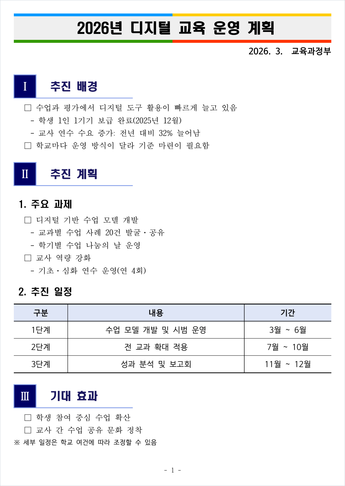
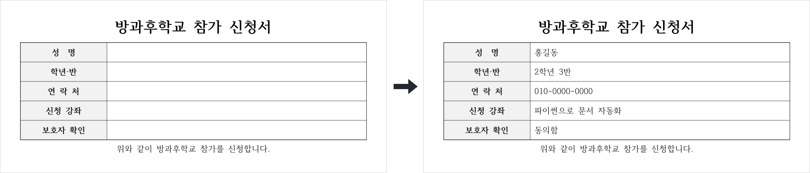

<p align="center">
  <h1 align="center">python-hwpx</h1>
  <p align="center">
    <strong>A Python engine that reads, edits and creates Hangul (HWPX·HWP) documents without Hancom Office</strong>
  </p>
  <p align="center">
    <a href="https://pypi.org/project/python-hwpx/"></a>
    <a href="https://pepy.tech/project/python-hwpx"></a>
    <a href="https://pypi.org/project/python-hwpx/"></a>
    <a href="https://github.com/airmang/python-hwpx/actions/workflows/tests.yml"></a>
    <a href="https://github.com/airmang/python-hwpx/blob/main/LICENSE"></a>
  </p>
  <p align="center">
    <a href="https://github.com/airmang/python-hwpx/blob/main/README.md">한국어</a> | English
    · <a href="https://github.com/airmang/python-hwpx/blob/main/docs/quickstart.md">Quickstart</a>
    · <a href="https://github.com/airmang/python-hwpx/blob/main/docs/usage.md">Usage guide</a>
    · <a href="https://airmang.github.io/python-hwpx/">API reference</a>
    · <a href="https://github.com/airmang/python-hwpx/blob/main/docs/migration-7.0.md">7.0 migration guide</a>
  </p>
</p>

python-hwpx does for Hangul documents what python-docx does for `.docx`. HWPX is XML (OWPML) inside a ZIP, so it
can be handled without Hancom Office. It runs on Windows, macOS, Linux and CI, and its only dependency is `lxml`.
HWP 5.0 (`.hwp`) files open through the same API and save as HWPX.

<p align="center">
  
</p>
<p align="center"><sub>A document made on python-hwpx 7.0.0 with the report style of python-hwpx-automation 8.0 (<code>from_markdown(md, style="report")</code>), as Hancom Office 12.30.0 draws the page (exported to PDF).</sub></p>

> **7.0 is out.** The save function, the public names and the home of some features changed.
> Coming from 6.x? Start with [What changed in 7.0, and why](#what-changed-in-70-and-why).

## Install

```bash
pip install -U python-hwpx      # Python 3.10+
```

## Quick start

Create a document. Styles are chosen by name; a name the document does not have fails on that line.

<!-- standalone-python-example -->

```python
from hwpx import HwpxDocument

doc = HwpxDocument.new()
doc.add_heading("2026 운영계획", level=1)
doc.add_paragraph("추진 배경", style="개요 2")  # Hangul numbers it "가."
doc.save("plan.hwpx")
```

Font size, alignment and table cells are read and changed in place. Every paragraph, including those in table
cells, headers and footnotes, can be walked together with where it sits.

<!-- standalone-python-example -->

```python
from hwpx import HwpxDocument

doc = HwpxDocument.new()
title = doc.add_paragraph("2026 운영계획")
title.alignment = "CENTER"
title.runs[-1].size = 16
table = doc.add_table(2, 2)
table.cell(0, 0).text = "기간"
table.cell(0, 1).text = "3월 ~ 7월"
for place in doc.text.iter_paragraphs(where={"cell"}):
    print(place.row, place.col, place.paragraph.text)
doc.save("plan.hwpx")
```

### Filling a form

Open an existing document with `HwpxDocument.open("report.hwpx")`. A `.hwp` opens the same way and the result is saved
as HWPX. To put values into a form and keep everything else byte for byte, save with `mode="patch"`.

```python
doc = HwpxDocument.open("application.hwpx")
for cell in doc.tables.map()["tables"][0]["cells"]:   # row, column and text of each cell
    print(cell["row"], cell["col"], cell["text"])
doc.tables[0].cell(0, 1).text = "Hong Gildong"
doc.tables[0].cell(1, 1).text = "Platform team"
report = doc.save("application-filled.hwpx", mode="patch", fallback="error")
```

<p align="center">
  
</p>
<p align="center"><sub>The blank form (left) and the form filled with <code>mode="patch"</code> (right), both as Hancom Office draws them.</sub></p>

`mode="patch"` copies every ZIP part you did not change, compressed bytes included; a save with no change gives the
same file. The report `save()` returns (`MutationReport`) says what changed. On a form with tables inside cells, the
table number in `doc.tables.map()` (`table_index`) counts the nested tables too, so pick with
`doc.tables.with_nested[table_index]`. Finding a cell by the label beside it is done by
[python-hwpx-automation](#companion-packages).

<sub>The first two examples run as they are. The third takes your own document as input; the per-example
Python-block status is frozen in the [execution ledger](https://github.com/airmang/python-hwpx/blob/main/docs/python-example-ledger.json).</sub>

## What it does

| | |
|---|---|
| **Read** | plain text the way Hangul's "save as text" writes it (`doc.text.plain()`), an outline within a character budget (`doc.text.outline()`), paragraphs of table cells, text boxes, headers and notes with their place (`doc.text.iter_paragraphs()`) |
| **Edit** | paragraphs, runs, character and paragraph formatting, headers and footers, page setup and page numbers, pictures, shapes, equations, memos, footnotes and endnotes |
| **Tables** | read and write cells, insert, delete, move rows and columns, merge and split cells, borders and fills, tables inside cells |
| **Forms** | read and fill form fields, patch saves that only put values in, FormFit that wraps or shrinks text so a value fits its cell |
| **Structure** | table of contents, cross references, bookmarks, hyperlinks, tracked changes, copying and merging between documents |
| **HWP 5.0** | read `.hwp` with the same API and save as HWPX; what could not be carried over is in `doc.conversion_report`; writing `.hwp` is experimental |
| **Checks** | package structure checks, a pre-save check that Hangul can open the file, save quality policies (`QualityPolicy`) |
| **Layout estimates** (experimental) | page count and line positions without Hangul (`estimate_pages`), line layout data written only where it is certain (`write_line_caches`) |

Development status is Production/Stable. What stays backward compatible is listed in
[stable API](https://github.com/airmang/python-hwpx/blob/main/docs/stable-api.md); `hwpx.experimental` and the features
marked "experimental" above may change.

## What changed in 7.0, and why

7.0 follows one rule: **what the engine tells you, and every file it writes, must be true.** The same file gives the
same answer, the answer is what the file says, and the engine does not write anything Hangul is not known to accept.
The six changes below all come from that rule.

### 1. Features that guess moved to python-hwpx-automation

**What changed:** Markdown and HTML conversion, importing other formats and the LangChain and LlamaIndex loaders,
finding form cells by their labels, mail merge, previews and format rule checks moved to
[python-hwpx-automation](https://github.com/airmang/python-hwpx-automation) 8.0.

**Why:** These features have no single right answer. Whether the cell beside a label is that item's cell, or how a
Markdown heading should look, is a guess or a taste. With guesses inside the engine, the promise "exactly what the file
says" can no longer be checked by a machine. So the line is drawn at "does it read and write what is in the file, or
does it guess and choose". Nothing was removed: arguments and results are the same as in 6.x, and calling an old name
raises an error that names the new place. The engine still depends on `lxml` only.

### 2. Saving is one function, `doc.save()`

**What changed:** `save_to_path`, `save_to_stream` and `save_report` became `doc.save(target)`, and `from_package` became
`open()`. `save()` takes a path or a stream and always returns a `MutationReport`.

**Why:** The four functions overlapped, yet returned `None`, a path or a report. To check what a save did, you had to
remember which one to call. Now the result of a save always comes back in the same shape, and a stream save that fails
part way is rolled back.

### 3. Public names follow one rule, and are frozen

**What changed:** `row_index=` → `row=`, `horz_rel_to=` → `horizontal_relative_to=`, `line_width='33'` →
`line_width_mm=0.12`, `table.get_cell_map()` → `table.cell_map`. The 79 root names 6.0 had kept with a warning are gone.

**Why:** 6.x mixed abbreviations, names copied from XML attributes, numbers without units (nothing in `'33'` says what
unit it is) and `get_` prefixes, so the API had to be memorized name by name. The rule has three parts: names are
spelled out, units are part of the name, and reads without arguments are properties. 7.0 is the last rename. The public
names are frozen in `tests/data/public_surface.json` and stay until the next major.

To finish in one step, 7.0 also removed names that 6.x had not warned about (the save functions among them), an
exception to the [stable API rules](https://github.com/airmang/python-hwpx/blob/main/docs/stable-api.md). In return,
calling a removed name tells you the new name and a one-line example on the spot.

### 4. Writes Hangul would not accept are refused

**What changed:** Every XML shape the engine writes is based on files Hangul itself saved; combinations without that
evidence are refused before writing, with an error that carries a `code`. A refused call leaves the document untouched.
Editing the document through a table or paragraph already removed from it is refused, and reading never changes the
document. Writing `.hwp` stays experimental, and overwriting the source or writing what could not be carried over is
blocked.

**Why:** The worst failure is a file saved without an error that Hangul then cannot open, or draws differently. A clear
refusal with a reason beats being silently wrong.

### 5. What used to need raw XML is public API

**What changed:** Table structure edits, object position, rotation and flipping, character and paragraph formatting,
form fields, footnotes and endnotes, tables of contents, cross references and tracked changes are public API.

**Why:** In 6.x these took direct XML edits through `.element`, and such edits skipped the engine's checks. Through the
public API, the refusals and checks of change 4 come along. Most of the roughly 21,000 lines (23%) the engine grew since
6.12.0 are this. `.element` remains as an escape hatch, but it is not a promised surface.

### 6. A new document no longer starts with a blank line

**What changed:** After `HwpxDocument.new()`, the first paragraph you add is `doc.paragraphs[0]`.

**Why:** A 6.x document always started with a blank line, which stayed as a useless empty line at the top of what you
made. This change shifts paragraph numbers by one without any error, so it comes first in the
[migration guide](https://github.com/airmang/python-hwpx/blob/main/docs/migration-7.0.md). To start as 6.x did, use
`HwpxDocument.new(empty_first_line=True)`.

### How to upgrade

1. `pip install -U python-hwpx`
2. Run your tests. Removed names raise errors that name the new ones.
3. Check what changes results without an error in the tables of the [7.0 migration guide](https://github.com/airmang/python-hwpx/blob/main/docs/migration-7.0.md).
4. If you use the features in change 1, `pip install -U "python-hwpx-automation>=8"`.

The full list is in the [changelog](https://github.com/airmang/python-hwpx/blob/main/CHANGELOG.md).

## Does Hangul open it?

Files made with python-hwpx are opened in real Hancom Office, and each result is written down with the version and
the date.

- **7.0.0** (2026-11-21, Hancom Office 12.30.0 on macOS): all 72 documents made with the 7.0.0 wheel opened. They
  include 54 edits of real documents of 27 kinds made by others, new documents, and the results of copying and merging
  between documents. Hangul on Windows has not been checked for 7.0.0 yet.
- Whole-corpus measurements of earlier versions are in [corpus metrics](https://airmang.github.io/python-hwpx/corpus-metrics.html).

These numbers measure whether Hangul accepts the file, not that it looks identical. The engine does not lay out pages:
it clears the line layout data of paragraphs whose text changed, and Hangul lays them out again when it opens the file.


## Companion packages

| | Repository | Role |
|---|---|---|
| 📦 | [`python-hwpx`](https://github.com/airmang/python-hwpx) | the engine that reads, edits and creates Hangul documents (this repository) |
| 🔌 | [`python-hwpx-automation`](https://github.com/airmang/python-hwpx-automation) | conversion, form filling, mail merge, previews, the `hwpx` CLI, the MCP server, the agent plugin sources |
| 🎯 | [`hwpx-plugins`](https://github.com/airmang/hwpx-plugins) | the Claude Code and Codex plugin catalogue (`hwpx-plugin@hwpx`) |

To use it from an agent, install the plugin:

```bash
claude plugin marketplace add airmang/hwpx-plugins && claude plugin install hwpx-plugin@hwpx
codex plugin marketplace add airmang/hwpx-plugins && codex plugin add hwpx-plugin@hwpx
```

It also works in a plain ChatGPT conversation. The chat's Python runtime cannot reach PyPI, so upload the
`python_hwpx-*.whl` from the [latest Release](https://github.com/airmang/python-hwpx/releases/latest) together with the
document and ask: "install the attached whl with pip, then open this .hwpx with python-hwpx and work on it". Detailed
instructions are in [using it in AI chats](https://github.com/airmang/python-hwpx/blob/main/docs/ai-assistants.md), and
there is an [llms.txt](https://airmang.github.io/python-hwpx/llms.txt) for AI tools.


> For older install commands, `pip install "python-hwpx[visual]"` still works, but the `visual`
> extra is empty and installs no render/PDF dependencies. That runtime belongs to
> `python-hwpx-automation[oracle]`.

## Comparison

| | python-hwpx | pyhwpx | pyhwp |
|---|---|---|---|
| **Needs Hangul installed** | no | yes (drives Hangul through Windows COM) | no |
| **Operating systems** | Linux · macOS · Windows · CI | Windows | Linux · macOS · Windows |
| **Formats** | `.hwpx` read and write, `.hwp` read | whatever Hangul opens | `.hwp` (v5) |
| **Edit and create** | ✅ | ✅ (Hangul does it) | mostly read |

## Known limits

- The engine does not lay out pages. Page numbers in tables of contents and cross references are filled in by Hangul
  when it opens the file.
- Page estimates and writing line layout data are experimental. Where they cannot follow an element, they return the
  reason instead of an estimate.
- Writing `.hwp` is experimental. Password-protected HWPX and encrypted or distribution HWP are not supported.
- `doc.shapes.add_raw()`, `add_control()` and XML changed through `.element` skip the engine's checks. For shapes, use
  the `doc.shapes` functions such as `add_line()` and `add_rectangle()`.

Open work and known defects are in the [issues](https://github.com/airmang/python-hwpx/issues).

## Documentation

[5-minute quickstart](https://github.com/airmang/python-hwpx/blob/main/docs/quickstart.md) ·
[Usage guide](https://github.com/airmang/python-hwpx/blob/main/docs/usage.md) ·
[Examples](https://github.com/airmang/python-hwpx/blob/main/docs/examples.md) ·
[API reference](https://airmang.github.io/python-hwpx/) ·
[Safe write contract](https://github.com/airmang/python-hwpx/blob/main/docs/safe-write-contract.md) ·
[Support matrix](https://github.com/airmang/python-hwpx/blob/main/docs/support-matrix.md) ·
[Error codes](https://github.com/airmang/python-hwpx/blob/main/docs/error-codes.md) ·
[Compared with python-docx](https://github.com/airmang/python-hwpx/blob/main/docs/comparison-python-docx.md)

## Contributing

[help wanted](https://github.com/airmang/python-hwpx/issues?q=is%3Aissue+is%3Aopen+label%3A%22help+wanted%22) ·
[Roadmap](https://github.com/airmang/python-hwpx/milestones) ·
[Discussions](https://github.com/airmang/python-hwpx/discussions) ·
[CONTRIBUTING](https://github.com/airmang/python-hwpx/blob/main/CONTRIBUTING.md)

New to HWPX internals? Start with the [internals guide](https://github.com/airmang/python-hwpx/tree/main/docs/internals).
The boundaries between the packages are in the [product boundary document](https://github.com/airmang/python-hwpx/blob/main/docs/architecture/product-boundary.md).

## Acknowledgements

- [OWPML, Open Word-Processor Markup Language (KS X 6101)](https://www.kssn.net/search/stddetail.do?itemNo=K001010119985): the Korean industrial standard underlying HWPX
- [hancom-io/hwpx-owpml-model](https://github.com/hancom-io/hwpx-owpml-model): reference model of the OWPML element structure
- [neolord0/hwpxlib](https://github.com/neolord0/hwpxlib): sample corpus
- [edwardkim/rhwp](https://github.com/edwardkim/rhwp): inspiration for the idempotence and verification gates, and a second viewer for compatibility checks
- 범정부오피스: ideas for public-sector document workflows

## License

Apache-2.0 ([LICENSE](https://github.com/airmang/python-hwpx/blob/main/LICENSE) · [NOTICE](https://github.com/airmang/python-hwpx/blob/main/NOTICE)) · Kohkyuhyun [@airmang](https://github.com/airmang) · [kokyuhyun@hotmail.com](mailto:kokyuhyun@hotmail.com)
